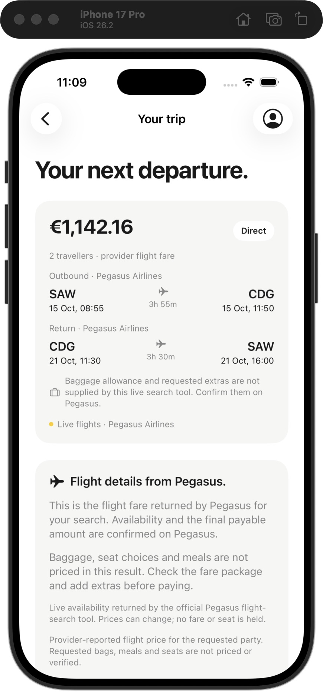
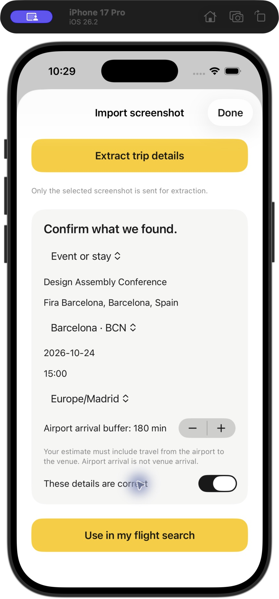
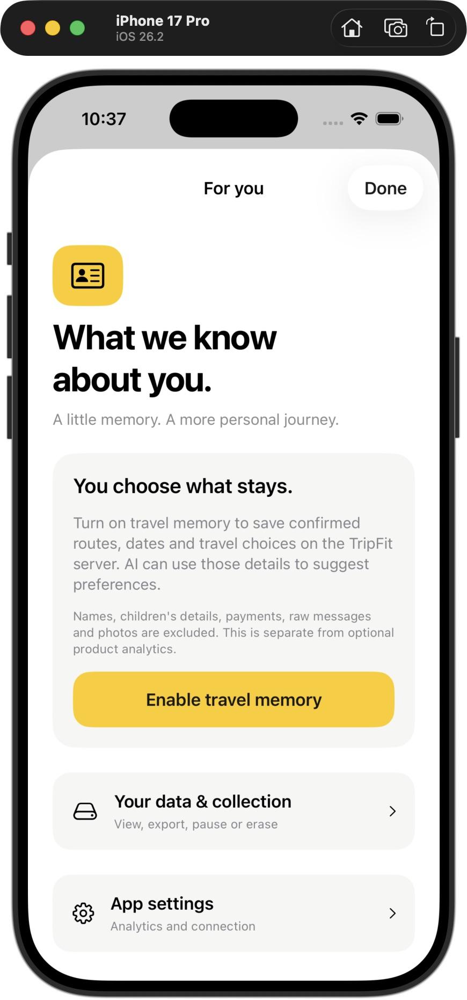
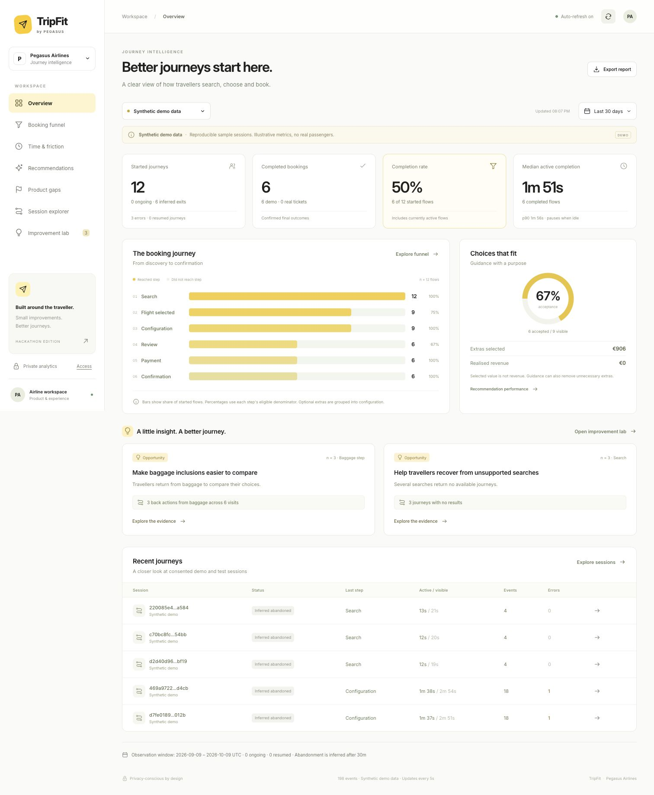
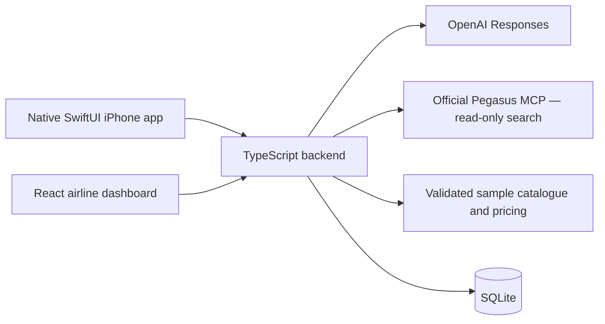

# Pegasus TripFit

## Hackathon submission

**[View the 10-slide pitch deck (PDF)](submission/Pegasus-TripFit-Pitch.pdf)** · [Download editable PowerPoint](submission/Pegasus-TripFit-Pitch.pptx) · [Presenter script and judge Q&A](submission/Presenter-Script.txt)

**Repository:** [github.com/MusayevAli/Pegasus](https://github.com/MusayevAli/Pegasus)

The deck covers the native AI trip planner, screenshot import, packing-photo guidance, live Pegasus search, customer-controlled memory and airline insights. This repository includes the Swift/Xcode app, backend, dashboard, setup instructions and verification evidence.

### A booking assistant that learns with permission.

TripFit is a **native SwiftUI iPhone app** and a connected **airline insights dashboard**. Travellers can describe a trip, import an event screenshot, review baggage guidance from a packing photo, and reuse preferences they control. Pegasus teams can explore consented journey events and turn measured friction into testable product experiments.

**SwiftUI · TypeScript · React · SQLite · OpenAI Responses · Official Pegasus MCP**

[Quick start](#quick-start) · [Feature tour](#feature-tour) · [Live vs demo](#live-vs-demo) · [Verification](#verification) · [Demo guide](docs/DEMO.md)

> **Hackathon prototype:** real Pegasus flight search and real OpenAI calls are connected. Live flight selection continues on Pegasus. The complete in-app extras and checkout experience uses explicitly labelled demo inventory; it charges nothing and issues no ticket.

## What makes Pegasus Pegasus

Pegasus emphasizes affordable, flexible travel and technology. Its digital journey lets guests choose services such as bags, seats and meals. TripFit applies that direction to a practical booking companion. [Why Pegasus](https://www.flypgs.com/en/about-pegasus/why-pegasus) · [Pegasus Help Center](https://www.flypgs.com/en/help-center)

- **Accessible travel:** the planner turns a person's budget and real trip requirements into an editable search, with provider-backed fares and visible tradeoffs.
- **Choice with clarity:** packing-photo guidance explains allowance fit and relevant options, including keeping the existing allowance. The customer confirms every change.
- **Digital convenience:** screenshot import reduces retyping, optional memory reuses confirmed preferences, and the airline dashboard identifies where customers need clearer guidance.

The intended business outcome is more completed journeys and more relevant extras. That is a pilot hypothesis to measure—not an uplift claimed by this prototype.

## Feature tour

| For the traveller | What TripFit does |
| --- | --- |
| **AI trip planner** | Converts a description into editable route, date, budget and travel requirements. Locked fields stay locked; ambiguous details need confirmation. Searches use provider records, and AI helps compare candidates or explain explicit alternatives when nothing matches. |
| **Screenshot import** | Extracts event or incoming-flight details from the selected image. The traveller confirms dates, local time, time zone and arrival buffer before applying them to a search. An independently booked incoming flight stays outside the onward price. |
| **Packing-photo guidance** | Identifies visible items and lets the traveller correct the list. Confirmed weight and dimensions—not an estimate of weight from a photo—determine allowance fit. Demo catalogue rules calculate options, including keeping the existing allowance, with explicit apply and undo. |
| **Personal travel memory** | With separate opt-in, confirmed routes and choices become observed preferences and evidence-linked AI suggestions. “What we know about you” shows values, sources and confidence. Add, correct, lock, unlock, forget or restore a preference; explicitly apply route requirements to a search. |
| **Data controls** | Inspect saved activity, pause collection, remove an activity, export JSON, clear history or erase the profile. Private profile access is scoped to the backend and kept in iPhone Keychain. |
| **Native booking demo** | Configure passengers, bags, seats, meals and bundles; review an itemised quote; cancel or retry safely; and save a clearly marked demo confirmation in My Trips. |

### From the implemented iPhone app

<table>
  <tr>
    <td align="center"></td>
    <td align="center"></td>
    <td align="center"></td>
  </tr>
  <tr>
    <td align="center">Live flight details</td>
    <td align="center">Review imported details</td>
    <td align="center">Choose what is remembered</td>
  </tr>
</table>

These are actual prototype screenshots. The event fixture is fictional; the memory screenshot shows consent. Displayed fares are captured results, not current availability guarantees.

### For the airline team

The private dashboard has seven working views: **Overview, Booking funnel, Time & friction, Recommendations, Product gaps, Session explorer, and Improvement lab**. It supports source/date filters, five-second refresh, JSON export, event timelines and links from hypotheses to their supporting metrics.

Code computes active median/p90, loading time, revisits, backtracking, errors and inferred abandonment. Recommendation acceptance uses actually visible recommendation/version × journey pairs; application, removal and retention remain separate. Selected extras value is **not revenue**.

OpenAI selects a measured observation and proposes a hypothesis, change and experiment. Exact evidence IDs, values, sample sizes and denominators must validate before a draft appears. Synthetic rehearsal data, recorded prototype activity and live provenance remain visibly separate. A hypothesis is not a causal finding or measured business uplift.



[See the verified AI experiment](docs/screenshots/dashboard-v2-ai-live.png) · [See a recorded native confirmation](docs/screenshots/dashboard-v2-native-confirmation.png) · [Metric definitions](docs/ANALYTICS.md)

## Live vs demo

| Capability | Live Pegasus | Demo booking |
| --- | --- | --- |
| Flights and fares | Real read-only results from the official Pegasus MCP; provider currency and party scope preserved | Separate searchable sample catalogue with dated flights |
| Comparison | Validated candidates from the same live search | Sample offers and catalogue rules |
| Bags, seats, meals and bundles | Availability and final price must be confirmed on Pegasus | In-app eligibility, inclusions, scoped selections and pricing |
| Review and checkout | Continue to an official Pegasus search page; no fare hold or reservation is created | Expiring quotes, itemised review and idempotent demo orders |
| Payment and ticketing | Completed outside TripFit on Pegasus if the traveller chooses to purchase | No charge and no ticket; confirmations use `DEMO-…` references |

**Live failures never silently substitute sample flights.** AI interprets inputs and proposes choices; it does not invent schedules, product IDs or prices. Flexible live searches have bounded date/destination coverage, which the UI discloses.

Authorised Pegasus NDC access is still required for in-app live extras, seats, repricing, orders and ticket issuance. The retained legacy PassKit code is an integration boundary, not an active payment method in the current demo. [Provider scope](docs/PROVIDERS.md) · [Integration prerequisites](docs/INTEGRATIONS.md)

## Quick start

**Requirements:** Node **22.13+**, npm, and a Mac with full Xcode for the iPhone app. The iOS target supports iOS 17+. Recorded builds used Xcode 26.3 and an iPhone 17 Pro simulator running iOS 26.2.

Run the following from this repository folder.

### 1. Start the backend

```sh
cd backend
npm ci
test -f .env || cp .env.example .env
npm start
```

The API runs at `http://127.0.0.1:3001`. SQLite is created locally and seeded with labelled synthetic analytics. No API key is needed for manual demo booking. Public Pegasus flight search is checked at runtime; a working network and available provider are required.

To enable AI features, set the following in `backend/.env` and restart the backend:

```dotenv
OPENAI_API_KEY=your_server_side_key
OPENAI_MODEL_TEXT=gpt-4.1-mini
OPENAI_MODEL_VISION=gpt-4.1-mini
AI_TIMEOUT_MS=20000
```

Keep the key server-side. Missing credentials, provider failures and invalid output produce an honest unavailable state; manual fields and measured evidence remain usable. Enabling AI does not enable payments or ticket issuance.

### 2. Start the dashboard

In a second terminal, from the repository folder:

```sh
cd dashboard
npm ci
npm run dev
```

Open **[http://127.0.0.1:5173](http://127.0.0.1:5173)**. Vite proxies `/api` to the backend. Start with **Synthetic demo data**, then select **Recorded prototype** after using the app with analytics consent enabled.

### 3. Run the iPhone app

Open [ios/PegasusTripFit.xcodeproj](ios/PegasusTripFit.xcodeproj), select the shared **PegasusTripFit** scheme and an installed iPhone simulator, then Run. Or use:

```sh
bash scripts/run-ios-simulator.sh
```

The script builds, boots, installs and launches the app. It accepts an optional simulator UDID. Set `DEVELOPER_DIR` if full Xcode is installed outside `/Applications/Xcode.app`.

Leave simulator code signing enabled: the project uses ad-hoc signing and simulator-only Keychain entitlements for travel memory. Physical devices require your own Apple Development team and provisioning.

The app defaults to **Live Pegasus**. Choose **Demo booking** to exercise the complete in-app checkout. Fresh searches, quotes and orders require the backend; saved trips and drafts persist locally, but cached results cannot create an offline booking.

### Connection and access

Open the profile icon → **App settings → Developer diagnostics**. The simulator backend address is `http://127.0.0.1:3001`.

For a physical iPhone, use a reachable backend address. Binding beyond loopback requires both `APP_ACCESS_TOKEN` and `ANALYTICS_ADMIN_TOKEN`; enter only the app token on the phone. The dashboard's **Private analytics → Access** uses the admin token. A same-LAN `.local` address supports the documented development setup; remote hosting requires HTTPS and authentication. Vite stays bound to loopback by default. Production dashboard assets need a same-origin API or reverse proxy. [Dashboard setup](dashboard/README.md)

## Customer learning and privacy

**Personal travel memory and product analytics have separate optional consent.** Declining either does not prevent manual booking.

- **Memory** stores confirmed route/date/choice facts with search or booking provenance. AI selects only allowed candidates with exact supporting activity IDs. Direct corrections are customer-confirmed; locked or forgotten preferences cannot be overwritten by learning. Confidence labels describe the available evidence, not calibrated probabilities.
- **Analytics** stores allowlisted pseudonymous events and timing, not session recordings. Opt-out stops new collection and clears queued device events. Previously uploaded analytics remain in the server database; deployment must define their retention policy.
- **Raw inputs** are excluded from stored memory and analytics: no names, raw prompts, photos, child ages, passport or payment details enter those datasets. Explicit AI extraction requests still send the selected text or image to OpenAI for processing.
- **Erasure scopes are explicit.** Clearing memory history preserves direct user corrections; deleting the entire profile removes those too and revokes access. Deleting a profile does not delete previously uploaded aggregate analytics.

No sensitive traits or personalised prices are inferred. [Personalization contract and controls](docs/PERSONALIZATION.md) · [Analytics privacy and definitions](docs/ANALYTICS.md)

## Architecture



The backend validates model output, provider responses, money and evidence. Credentials stay outside the client bundles. Personal profiles and aggregate analytics use separate storage tables and access policies.

| Area | Location |
| --- | --- |
| Native screens, typed API, booking state and persistence | [ios/App](ios/App) |
| Live provider, AI extraction, sample pricing and demo orders | [backend/src/v2](backend/src/v2) |
| Personal memory and scoped access | [backend/src/personalization.ts](backend/src/personalization.ts) |
| Event ingestion and aggregate metrics | [backend/src/analytics.ts](backend/src/analytics.ts) |
| Airline dashboard | [dashboard](dashboard) |
| Shared wire contracts | [shared](shared) |
| Verification harnesses and packaging | [scripts](scripts) |

## Verification

Recorded verification on **9 October 2026 UTC**:

| Check | Result and evidence |
| --- | --- |
| Backend | **80 tests passed**, TypeScript build passed — [verification](docs/VERIFICATION.md) |
| Native booking state | **58 headless checks**, plus real local HTTP search/comparison and separate demo-order evidence — [report](docs/booking-v2-model-verification.json) |
| Native memory privacy | **26 checks**, plus real HTTP consent, learning, correction, opt-out, export and erasure — [report](docs/travel-profile-model-verification.json) |
| Retained Swift domain tests | **20 passed** — [verification](docs/VERIFICATION.md) |
| Native app and dashboard | Xcode Simulator build and dashboard production build passed; actual UI observations documented — [native](docs/VERIFICATION.md), [dashboard](dashboard/VERIFICATION.md) |
| Real AI and provider calls | Text, images, comparison, memory learning, aggregate insights and Pegasus availability — [evidence catalogue](docs/VERIFICATION.md#genuine-live-model-evidence) |

These checks establish implementation behavior, not customer conversion, retention or revenue gains. Live model tests used fictional travel inputs and inspected image fixtures; profile tests did not upload existing customer histories.

Run the checks locally:

```sh
npm --prefix backend test
npm --prefix backend run build
npm --prefix dashboard run build
bash scripts/test-booking-v2-model.sh
bash scripts/test-travel-profile-model.sh
swift test --package-path ios
```

Optional backend-connected booking smoke test:

```sh
bash scripts/test-booking-v2-model.sh --online http://127.0.0.1:3001
```

This uses test travellers and creates a demo order, not a charge or airline booking. Keep the backend running.

**Remaining validation:** complete native packing-photo → measurements → apply/undo UI acceptance, final real Keychain opt-in retest after the simulator signing repair, physical-device camera/signing, full VoiceOver, maximum Dynamic Type and iOS 17 runtime checks. Actual image API calls and native packing state checks passed; they are not substituted for that UI coverage. The verification notes record these boundaries explicitly.

## Explore the project

- [Demo walkthrough](docs/DEMO.md)
- [Verification and recorded evidence](docs/VERIFICATION.md)
- [Provider capabilities and live integration scope](docs/PROVIDERS.md)
- [Travel memory and data controls](docs/PERSONALIZATION.md)
- [Analytics definitions](docs/ANALYTICS.md)
- [Asset provenance](docs/ASSETS.md)

Source and simulator archives can be regenerated after a successful native build with `python3 scripts/package-deliverables.py`. The simulator package is not a physical-device IPA. Packaging excludes credentials, local databases, dependencies and developer-local files.

*Independent Pegasus hackathon concept. No airline endorsement, production certification or measured business uplift is claimed.*
